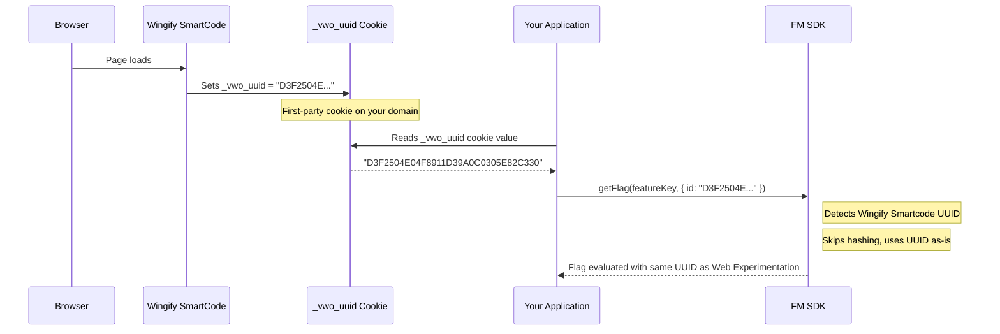

## Overview

Wingify Web Experimentation and Feature Management (FM) are two separate products that can coexist on the same page. When both are running, they independently identify users — Web Experimentation via a browser cookie (\_vwo_uuid), and FM via a userId passed in userContext. By default, these two identifiers are different, which means a visitor bucketed into a Web Experimentation campaign will be tracked as a different user in FM.

This guide explains how to bridge the two systems by reading the Web Experimentation UUID from the browser cookie and passing it as the userId in FM's userContext, ensuring consistent user identity across both products.

Important to note, that this will not work for mobile SDKs, due to the dependence on cookies. The flow described here, is best suited for client (JS, React) and serverSide SDKs (Node, Java, Python etc), used in tandem with the Web Experimentation product.

<Callout icon="fa-circle-info" theme="info">
  ### Note

  Ensuring that the UUID is the same, does not guarantee that the experience delivered will be the same. Web Experimentation and FM are two different products, and will render experiences according to their respective flag and campaign configuration.
</Callout>

## How Wingify Web Experimentation Identifies Visitors

Wingify Web Experimentation automatically sets a first-party cookie named _vwo_uuid in the visitor's browser when the Wingify SmartCode loadscalled_ vwo_uuid in the visitor's browser when the VWO SmartCode is loaded.

Cookie details:

- Name:        \_vwo_uuid
- Format:      33-character string — a prefix letter (D for desktop/browser or J for JavaScript environments) followed by 32 hexadecimal characters
  Example: D3F2504E04F8911D39A0C0305E82C330
- Scope:       Set on your domain (first-party)

This UUID is the primary visitor identifier used by Wingify Web Experimentation for bucketing, analytics, and reporting.

<Callout icon="fa-circle-info" theme="info">
  ### Note

  The \_vwo_uuid cookie is only generated after the Wingify SmartCode has been installed on the website and a visitor loads the page for the first time.
</Callout>

## How FM SDK Handles userId

When you call getFlag(), you pass a userContext object containing an id (the userId). Normally, FM converts this userId into an internal UUID using UUIDv5 hashing — deriving a deterministic hash from the userId combined with your accountId. This is done to protect your privacy and ensure that Wingify servers never store any PII, even accidentally.

Standard UUID Conversion Flow:

```text
userId (string)  →  UUIDv5 hash(userId + accountId namespace)  →  internal UUID
```

This internal UUID is what FM uses for bucketing, feature rollouts, and reporting.

## The Exception: Web Experimentation UUID Passthrough

FM's SDKs include a special detection mechanism: if the userId you provide matches the Web Experimentation UUID format — a D or J prefix followed by exactly 32 hexadecimal characters — the SDK skips the hashing step entirely and uses the provided userId directly as the internal UUID.

This is the key to cross-product identity alignment.

## Step-by-Step: Unifying User Identity

### Step 1 — Read the Web Experimentation UUID from the Cookie

The \_vwo_uuid cookie is accessible from client-side JavaScript running on the same domain:

```javascript
function getWingifyUuid() {
  const match = document.cookie.match(/(?:^|;\s*)_vwo_uuid=([^;]+)/);
  return match ? decodeURIComponent(match[1]) : null;
}

const wingifyUuid = getWingifyUuid();
// Example value: "D3F2504E04F8911D39A0C0305E82C330"
```

<Callout icon="fa-circle-info" theme="info">
  ### Note

  If the visitor has not yet been tracked by Wingify Web Experimentation (e.g., on their very first page load), this function returns null. Always implement a fallback userId.
</Callout>

### Step 2 — Pass the UUID as userId in FM userContext

```javascript
import { init } from 'wingify-fme-node-sdk';

const wingifyClient = await init({
  sdkKey: 'WINGIFYYOUR_SDK_KEY',
  accountId: 'WINGIFYYOUR_ACCOUNT_ID',
});

const wingifyUuid = getWingifyUuid();

const userContext = {
  id: wingifyUuid || 'fallback_user_id',
};

const flag = await wingifyClient.getFlag('your_feature_key', userContext);

if (flag.isEnabled()) {
  // serve the feature
}
```

Because the value of id matches the Web Experimentation UUID format, FM uses it as-is — no hashing. The same UUID that Wingify Web Experimentation uses for this visitor is now the identifier in FM as well.

## Complete Example

```javascript
// wingify-helper.js

function getWingifyUuid() {
  const match = document.cookie.match(/(?:^|;\s*)_vwo_uuid=([^;]+)/);
  return match ? decodeURIComponent(match[1]) : null;
}

async function evaluateFeatureFlag(wingifyClient, featureKey, fallbackUserId) {
  const wingifyUuid = getWingifyUuid();
  const userId = wingifyUuid || fallbackUserId;

  const userContext = { id: userId };
  const flag = await wingifyClient.getFlag(featureKey, userContext);

  return {
    isEnabled: flag.isEnabled(),
    variables: flag.getVariables(),
    userId,
    usingWebUuid: !!wingifyUuid,
  };
}
```

## Prerequisites

1. Wingify SmartCode must be installed and running on your website (generates the \_vwo_uuid cookie)

## How it all fits together



<br />

## Important Considerations

<Callout icon="fa-circle-info" theme="info">
  ### Note

  Cookie availability: The \_vwo_uuid cookie is only set after Wingify SmartCode has run on the page. For brand-new visitors on their very first page view, the cookie may not exist yet. Always provide a fallback userId
</Callout>

<Callout icon="fa-triangle-exclamation" theme="warning">
  ### Warning

  Do not modify the raw cookie value before passing it to FM. Any alteration (trimming, lowercasing, encoding) will cause validation to fail and the SDK will fall back to hashing instead of using the value as-is
</Callout>

<br />
