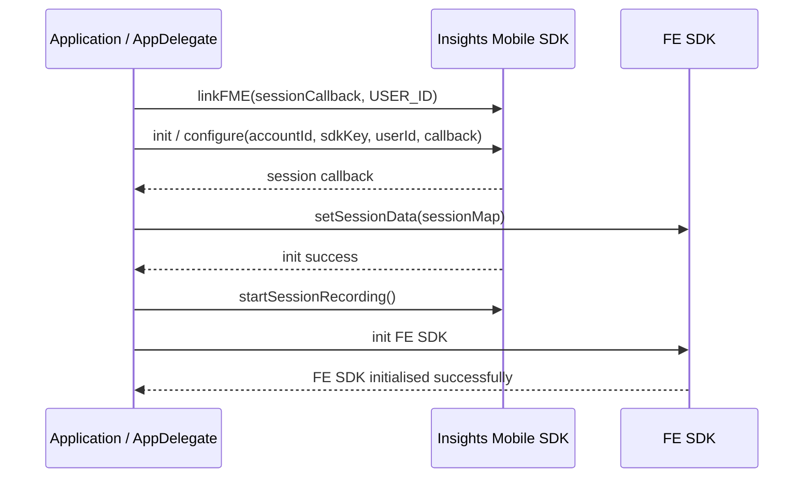

# Introduction

This guide outlines the integration process for the **[Wingify Feature Experimentation(FE) SDK](https://developers.wingify.com/v2/docs/fme-overview) and [Wingify Insights Mobile SDK](https://developers.wingify.com/reference/mobile-insights-introduction)** to ensure seamless session data synchronization.

With this integration, customers can **link session data** between Wingify Insights Mobile SDK and Wingify FE SDK, enabling **post-segmentation of session data** based on various attributes. This empowers them to analyze user behavior more effectively, identify friction points, and optimize user experiences with precise insights.

Benefits of Integrating Both SDKs:

* Seamlessly link user sessions between Wingify Insights Mobile SDK and Wingify FE SDK.
* Post-segment session data based on specific attributes or flags.
* Ensure session consistency when sessions are renewed in the Wingify Insights Mobile SDK.
* Enhance tracking, analysis, and insights across both platforms.

# Prerequisites

Before integrating, ensure the following:

* You have access to the latest versions of both SDKs.
* You have already added **Wingify Insights Mobile SDK** and **Wingify FE SDK** separately in your application.
* You have your **Wingify Insights Mobile SDK API key** and **Wingify FE SDK credentials** along with the **AccountId** and unique **USER\_ID**

## Integration

While integrating both SDKs, ensure the following:

* Implement the **Session Callback** as shown and pass the received session data to the **Wingify FE SDK** for session validation.

```kotlin
private fun getSessionCallback(): IVwoSessionCallback {
    return IVwoSessionCallback { sessionData ->
        FMEConfig.setSessionData(sessionData)
    }
}
```
```swift
func vwoScreenCaptureSessionDidUpdate(sessionData: [String : Any]) {
    FmeConfig.setSessionData(sessionData)
}
```

* **USER\_ID** is mandatory to link both SDKs and ensure session continuity by passing the session callback.

```kotlin
val sessionCallback = getSessionCallback()
VWOInsights.linkFME(sessionCallback, "USER_ID")
```
```swift
VWO.linkFme(sessionCallback: self, userId: "USER_ID")
```

* **Initialize the Wingify Insights Mobile SDK first**, as it handles session recording and tracking.
* **Wait for a successful initialization callback** from Wingify Insights before starting the **Wingify FE SDK** to avoid misalignment in session data.
* **Start session recording before initializing the Wingify FE SDK** to ensure all interactions are captured correctly.

## Step 1: Configure and Initialize the Wingify Insights Mobile SDK

```kotlin
package com.example.myapp

import android.app.Application
import android.util.Log
import com.vwo.VWO
import com.vwo.insights.VWOInsights
import com.vwo.insights.exposed.IVwoInitCallback
import com.vwo.insights.exposed.IVwoSessionCallback
import com.vwo.insights.exposed.models.ClientConfiguration
import com.vwo.models.user.FMEConfig
import com.vwo.models.user.VWOInitOptions

class MyApplication : Application() {

    override fun onCreate() {
        super.onCreate()
        initVWOInsights()
    }

    private fun initVWOInsights() {
        val config = ClientConfiguration("ACCOUNT_ID", "SDK_KEY", "USER_ID")

        /* Below two lines are extra code needed to link both the SDKs. */

        // SessionCallback to revalidate sessions
        val sessionCallback = getSessionCallback()
        // USER_ID is mandatory to link between both the SDKs
        VWOInsights.linkFME(sessionCallback, "USER_ID")

        // Initialize Insights Mobile SDK
        VWOInsights.init(this, object : IVwoInitCallback {
            override fun vwoInitSuccess(message: String) {
                // Insights SDK initialized successfully
                VWOInsights.startSessionRecording()

                // Init FE SDK
                initVWOFME()
            }

            override fun vwoInitFailed(message: String) {
                Log.i("init", "vwoInitFailed: $message")
            }
        }, config)
    }

    private fun getSessionCallback(): IVwoSessionCallback {
        return IVwoSessionCallback { sessionData ->
            FMEConfig.setSessionData(sessionData)
        }
    }

    private fun initVWOFME() {
        // See Step 2
    }
}
```
```swift
import VWO_FME
import VWO_Insights

@main
class AppDelegate: UIResponder, UIApplicationDelegate, VWOSessionCallback {
    func application(_ application: UIApplication, didFinishLaunchingWithOptions launchOptions: [UIApplication.LaunchOptionsKey: Any]?) -> Bool {
        self.initMiSDK()
        return true
    }

    func initMiSDK() {
        // SessionCallback to revalidate sessions and userId is mandatory
        VWO.linkFme(sessionCallback: self, userId: "USER_ID")

        VWO.configure(accountId: "ACCOUNT_ID", sdkKey: "SDK_KEY", userId: "USER_ID", completion: { result in
            switch result {
            case .success(_):
                // Insights SDK initialized successfully
                VWO.startSessionRecording()

                // Init FE SDK
                self.initVWOFME()
            case .failure(_):
                print("Insights initialization failed")
            }
        })
    }
}
```

## Step 2: Initialize the Wingify FE SDK

```kotlin
private fun initVWOFME() {
    val vwoInitOptions = VWOInitOptions()
    vwoInitOptions.sdkKey = "FME_SDK_KEY"
    vwoInitOptions.accountId = ACCOUNT_ID // Int account id
    vwoInitOptions.context = applicationContext

    VWO.init(vwoInitOptions, object : com.vwo.interfaces.IVwoInitCallback {
        override fun vwoInitSuccess(vwoClient: VWO, message: String) {
            // use vwoClient to invoke FE SDK APIs
        }

        override fun vwoInitFailed(message: String) {
            Log.i("VWOSession", "FE Init failed: $message")
        }
    })
}
```

## Step 3: Implement Session Callback

```kotlin
private fun getSessionCallback(): IVwoSessionCallback {
    return IVwoSessionCallback { sessionData ->
        // Pass the received session data to the FE SDK for session validation
        FMEConfig.setSessionData(sessionData)
    }
}
```
```swift
func vwoScreenCaptureSessionDidUpdate(sessionData: [String : Any]) {
    // Pass the received session data to the FE SDK for session validation
    FmeConfig.setSessionData(sessionData)
}
```

## Sequence Diagram



<br />

# Summary

This document outlines integrating the **Wingify Insights Mobile SDK** and **Wingify FE SDK** in both **Android** and **iOS** applications. Developers can ensure accurate tracking and analysis for experiments and feature rollouts by linking the session data between both SDKs.
